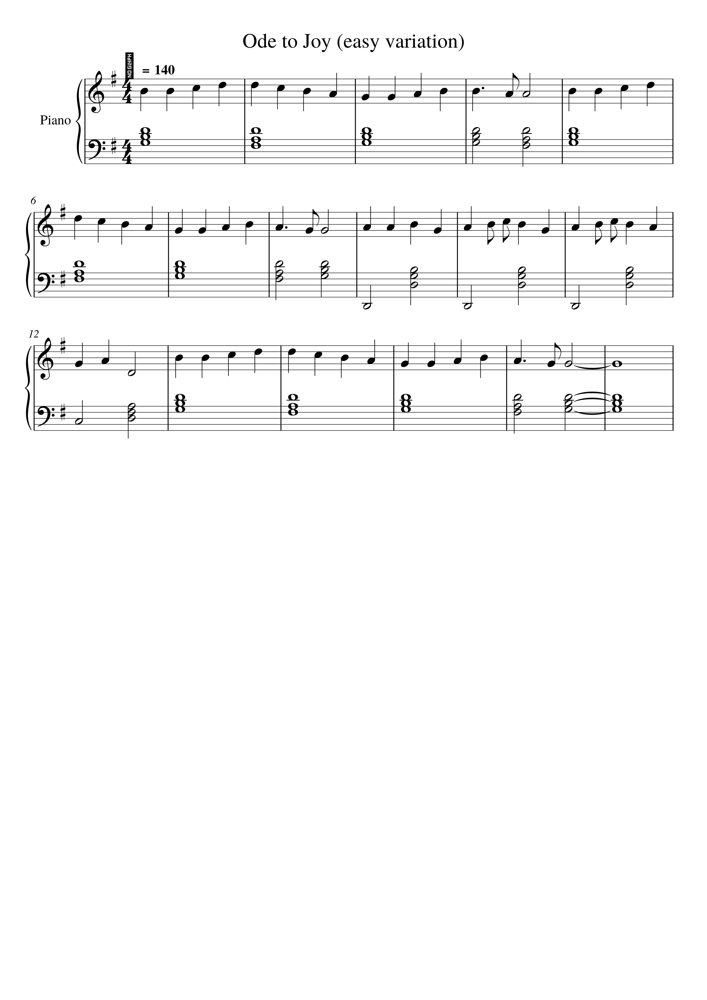
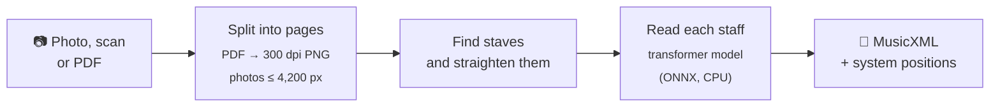

<div align="center">

# 🎼 Clara Wieck reader

**Sheet music in. MusicXML out.**

A small, self-hostable reading service built on the [homr](https://github.com/liebharc/homr)
recognition engine. Send it photos, scans or PDFs of sheet music and it returns MusicXML,
bar by bar, with where each line of music sits on the page.

[](LICENSE)
[](Dockerfile)
[](https://fastapi.tiangolo.com)
[](Dockerfile)
[](#hosting)

[Quick start](#-quick-start) · [API](#-api) · [Hosting](#-hosting) · [Accuracy](#-accuracy) · [License](#-license)

</div>

---

> *Named after **Clara Wieck** (1819–1896), the pianist famous for reading anything put in front of her.*

## ✨ What it does

<table>
<tr>
<td width="45%" valign="top">



</td>
<td width="55%" valign="top">

Send it this page and you get back:

- **MusicXML** for every bar, both hands, ready for MuseScore, Finale, Dorico, Sibelius or your own code
- **Where each system sits** on the page, so every bar can be traced back to the image it came from
- **Timing** for each page, and any warnings the reader raised

What it handles:

- 📷 Phone photos: tilted, unevenly lit, slightly blurred
- 📄 Multi-page PDFs, rendered at 300 dpi
- 🖼️ PNG, JPEG and WebP
- 🔒 An optional shared token, so only your apps can use it

No GPU and no outside services. Everything runs on the CPU, in one container.

</td>
</tr>
</table>

## 🧠 How it works



**The recognition engine is [homr](https://github.com/liebharc/homr)**, an open-source
optical music recognition project. It finds the staves on a page, straightens them, and reads
each one with a trained transformer. Every note, rhythm and signature in the output is homr's.

Clara Wieck is the service around it. It gives homr a clean HTTP API with an optional token,
turns PDFs and phone photos into pages homr reads well, reports where each system sits on the
page, keeps one bad page from spoiling the rest, and ships everything as one CPU-only
container with the models built in. It also includes a benchmark that measures how well
pages are read, bar by bar.

## 🚀 Quick start

### With Docker

```bash
docker build -t clara-wieck .
docker run -p 8100:80 clara-wieck
```

The model weights (about 150 MB) are baked into the image, so the first request isn't slow.

### With Python

```bash
python -m venv .venv && .venv/bin/pip install -r requirements.txt
.venv/bin/homr --init --no-title          # downloads the models once (about 150 MB)
.venv/bin/uvicorn reader.app:app --port 8100
```

### Read your first page

```bash
curl -F "file=@tests/fixtures/page.png" http://localhost:8100/read
```

```json
{"engine": "homr", "pages": [
  {"page": 1, "musicxml": "<?xml version='1.0' encoding='utf-8'?><score-partwise ...", "seconds": 24.1, ...}
]}
```

## 📡 API

### `POST /read`

Send a page or a whole PDF in **one of two ways**:

| Style | Body | Example |
|---|---|---|
| Multipart | a `file` field (PNG, JPEG, WebP or PDF), optional `engine` field | `curl -F "file=@page.jpg" …/read` |
| JSON | `{"data": "<base64 or data: URL>", "engine": "homr"}` | handy from a browser |

If the server has `READER_TOKEN` set, add `Authorization: Bearer <READER_TOKEN>`.

**Response**

```json
{
  "engine": "homr",
  "pages": [
    {
      "page": 1,
      "musicxml": "<?xml ...",
      "seconds": 24.1,
      "systems": [{"left": 0.07, "top": 0.12, "right": 0.93, "bottom": 0.23}],
      "notes": []
    },
    {"page": 2, "error": "…"}
  ]
}
```

| Field | Meaning |
|---|---|
| `musicxml` | The page as MusicXML. Line breaks are marked with `<print new-system="yes"/>`. |
| `systems` | Where each line of music sits, as fractions of the page, top to bottom. They match the line breaks in the MusicXML, so each bar can be traced back to the image. |
| `seconds` | How long that page took to read. |
| `notes` | Anything the reader reported that a person should know about. |
| `error` | Present only when that page failed. The other pages still come back. |

**Errors**

| Status | When |
|---|---|
| `400` | Empty file, not an image or PDF, a PDF over 40 pages, bad base64, or an unknown engine |
| `401` | `READER_TOKEN` is set and the request's token is missing or wrong |
| `413` | The upload is larger than `READER_MAX_BYTES` (40 MB by default) |

### `GET /health`

```json
{"ok": true, "name": "Clara Wieck reader", "engines": ["homr"], "default": "homr", "busy": false}
```

`busy` is `true` while a page is being read. Pages are read **one at a time**: reading is
CPU-heavy, and running two at once on a small server only makes both slower.

## ⚙️ Configuration

| Variable | Default | What it does |
|---|---|---|
| `READER_TOKEN` | *(unset)* | Shared secret. When set, `/read` requires `Authorization: Bearer <token>`. **Set this on any public deployment.** |
| `READER_ENGINE` | `homr` | Engine used when a request doesn't name one. |
| `READER_MAX_BYTES` | `41943040` (40 MB) | Largest upload accepted. |
| `PORT` | `80` (in Docker) | Port the server listens on. |

## ☁️ Hosting

**Recommended size: 2 CPUs and 4 GB of memory**, which reads about two pages a minute.
Peak memory is about 1.5 GB on a 2200 × 3100 page and over 2 GB on larger ones, so 2 GB
only handles modest pages.

| Platform | How |
|---|---|
| **Fly.io, Render, Railway** | Point them at this repository. They run the `Dockerfile` as it is and set `PORT` themselves. |
| **Vercel** | `vercel.json` selects the container build. The image is about 1 GB, so it needs Vercel's large-function support. Requests are capped at 4.5 MB there. |
| **Your own machine** | `docker run -p 8100:80 -e READER_TOKEN=… clara-wieck` |

> [!TIP]
> On platforms that stop idle containers, the first request after a quiet spell includes
> start-up time. Send one page yourself before a demo to warm it up.

## 🎯 Accuracy

Measured on known pieces, engraved as clean A4 pages and then made to look like phone photos
(tilt, perspective, uneven light, blur, JPEG):

| Piece | Version | Notes right | Bars exactly right | Key & time | Sec / page |
|---|---|:---:|:---:|:---:|:---:|
| Mozart, Menuett K. 2 | clean | 96% | 21 / 24 | ✅ | 21 |
| | photo | 96% | 21 / 24 | ✅ | 19 |
| Bach, Polonaise in G minor | clean | 93% | 12 / 16 | ✅ | 20 |
| | photo | 93% | 12 / 16 | ✅ | 19 |
| Bach, French Suite no. 6 (excerpt) | clean | 88% | 9 / 24 | ✅ | 28 |
| | photo | 91% | 9 / 24 | ✅ | 27 |

**The short version:** on typical engraved piano music, about **9 notes in 10** come out exactly
right, **photos do about as well as clean scans**, and key and time signatures came out right
every time. Unusual notation, such as music without barlines, is the weak spot.

The full results and method are in [**BENCHMARK.md**](BENCHMARK.md).

<details>
<summary><b>Run the benchmark yourself</b></summary>

`bench/` engraves pieces whose notes are known with [Verovio](https://www.verovio.org),
makes phone-photo versions, reads both, and scores the result bar by bar against the original.

```bash
.venv/bin/pip install -r requirements-bench.txt
.venv/bin/python -m bench.run --app <folder with public/library/> --pieces 6
```

`--app` points at a folder whose `public/library/` holds the known pieces (an `index.json`
plus one JSON file per piece). Results are saved to `bench/out/` after each piece.

</details>

## 🧪 Tests

```bash
.venv/bin/python -m pytest tests              # fast, with a stand-in engine
RUN_HOMR=1 .venv/bin/python -m pytest tests   # also reads a real page with homr
```

## 🧩 Adding another engine

Engines live in `reader/engines/`. Each one takes a page image and returns MusicXML:

```python
from reader.engines.base import Engine, PageResult

class MyEngine(Engine):
    name = "mine"

    def available(self) -> bool:
        return True                      # e.g. check the models are installed

    def read_page(self, image_path: str) -> PageResult:
        ...
        return PageResult(musicxml=xml, seconds=t, engine=self.name, systems=systems)
```

Register it in `ENGINES` in `reader/app.py`, and callers can pick it with `engine=mine`.

## 📁 Project layout

```
reader/
  app.py              the HTTP API (/read, /health)
  pages.py            uploads → page images (PDF rendering, photo rotation, resizing)
  engines/
    base.py           the Engine interface
    homr_engine.py    the homr engine
tests/                API tests and a sample page
bench/                accuracy benchmark (engrave → photograph → read → score)
Dockerfile            CPU image with models included
vercel.json           container build for Vercel
```

## 📜 License

**AGPL-3.0**, because homr is AGPL-3.0. If you run a modified version of this service for
other people over a network, the AGPL asks you to offer them its source. Apps that only
call it over HTTP keep their own license. *(This is a summary, not legal advice.)*

The model weights belong to homr and are downloaded from its GitHub releases.
[Verovio](https://www.verovio.org) (LGPL-3.0) and CairoSVG (LGPL-3.0) are used only by the benchmark.

<div align="center">
<br>
<sub>Built on <a href="https://github.com/liebharc/homr">homr</a> · Made for musicians who'd rather play than type in notes</sub>
</div>
